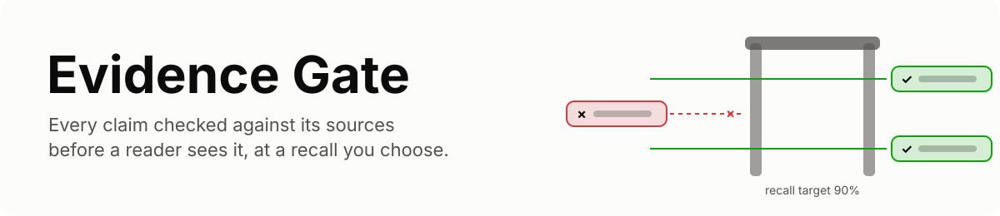
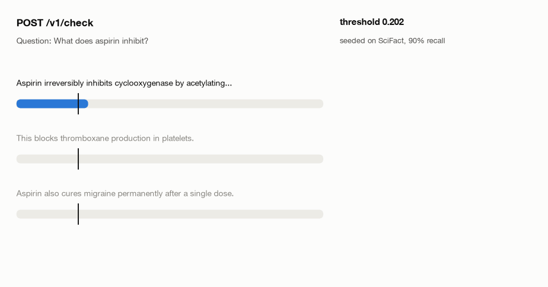
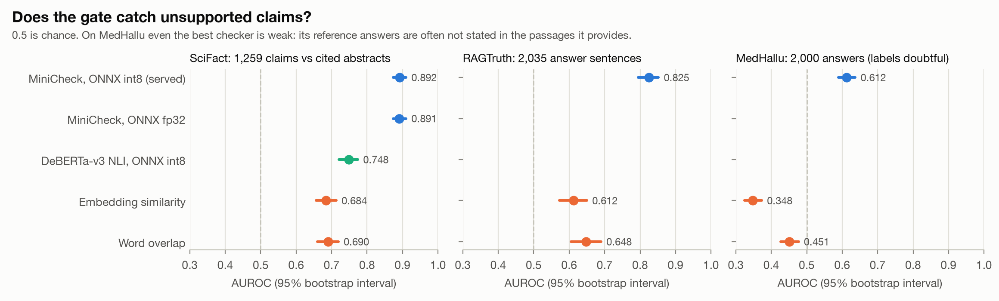
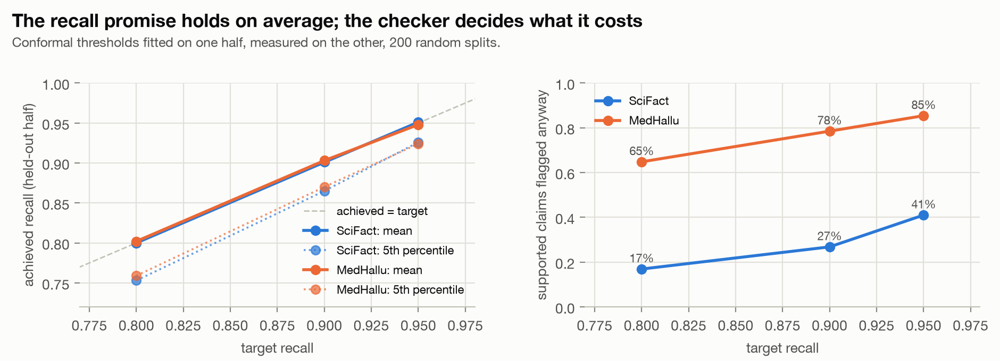
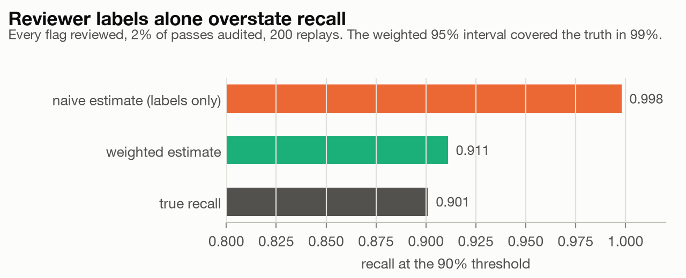
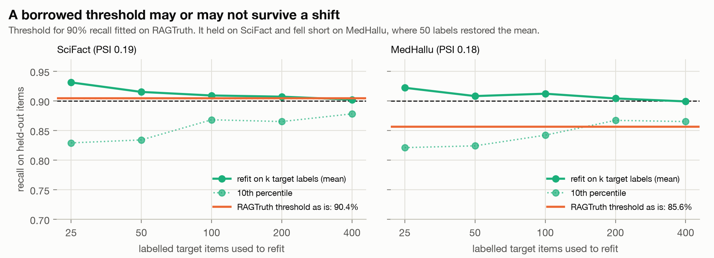
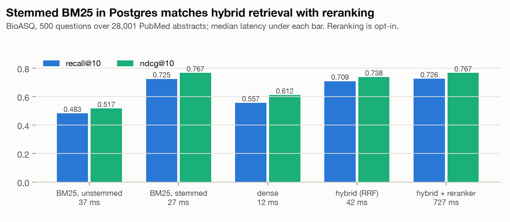
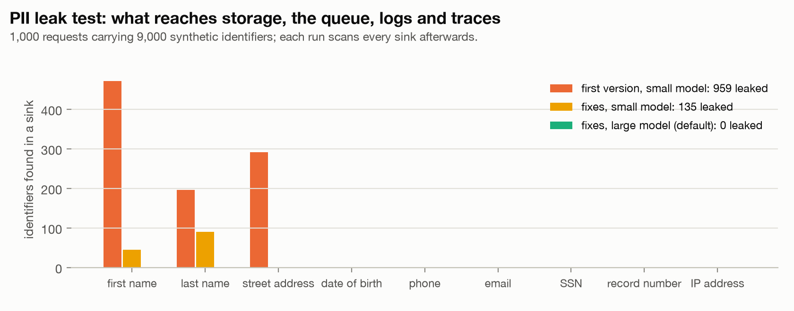
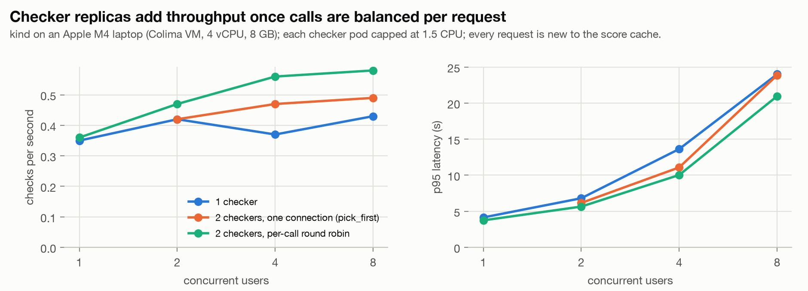
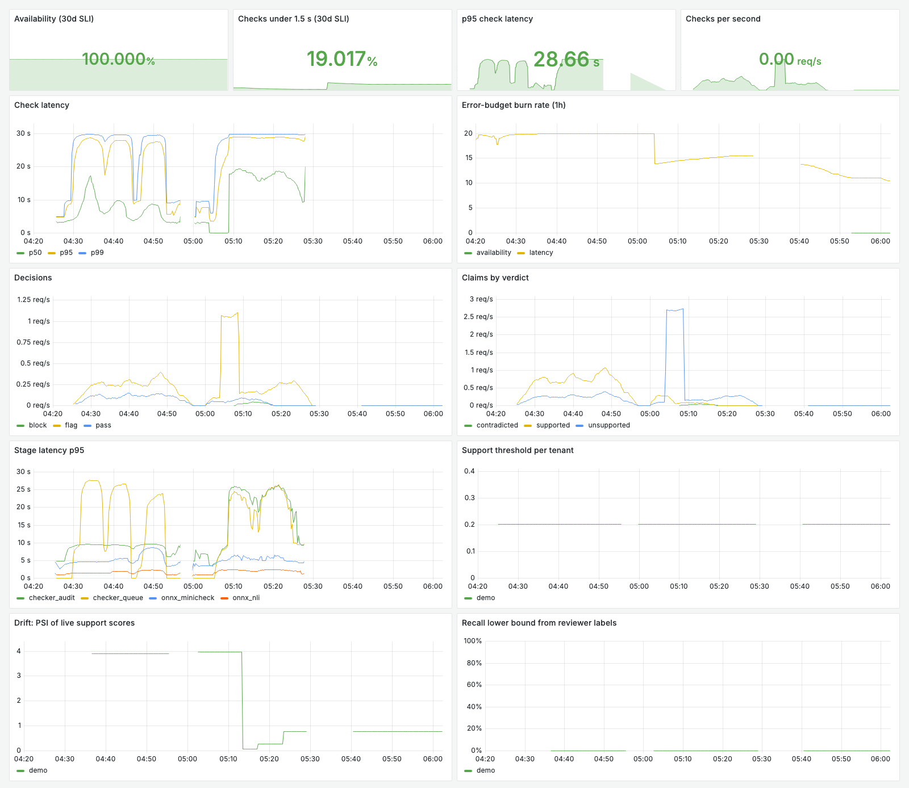

<picture>
  <source media="(prefers-color-scheme: dark)" srcset="docs/assets/banner-dark.svg">
  
</picture>

[](https://github.com/Sanika0212/Evidence-Gate/actions/workflows/ci.yml)


**Evidence Gate checks every claim in a RAG answer against its sources before the answer
reaches a reader, and lets each deployment choose the share of unsupported claims it must
catch.**

Retrieval does not stop hallucination. RAGTruth's annotators found unsupported content in
answers from all six models they studied, even with the right passages in the prompt, and
a 2024 study of commercial legal research tools built on retrieval found hallucinations in
17% to 33% of answers. Guardrails exist (Bedrock contextual grounding checks, Azure
groundedness detection, NeMo Guardrails, HHEM, Lynx), but each returns a score you compare
with a threshold you pick by hand. Nobody can then say what share of unsupported claims
that threshold catches on *your* questions, or notice when it stops catching them.

Evidence Gate turns the threshold into a promise you can check:

1. **A recall target per deployment.** A tenant asks for "flag at least 90% of
   unsupported claims". The calibrator sets the threshold by split conformal calibration
   on that tenant's labelled claims and reports the false-alarm rate it costs.
2. **Recall measured in production, without bias.** Reviewers label every flagged claim
   and a 2% random sample of claims that passed. Each label carries an inverse-probability
   weight, and the interval on misses is exact, so the estimate is not inflated by only
   looking at flags.
3. **Drift-aware.** An hourly job compares live support scores with the calibration
   scores and recall on recent labels with the target, raises an alert, and refits the
   threshold when either slips.
4. **Why it failed, confirmed.** Flagged answers go to a queue; a worker names the likely
   cause (retrieval miss, conflicting sources, and others) and replays the answer with the
   fix to confirm it, using [Groundsight](https://github.com/Sanika0212/Groundsight).
5. **Run like a production service.** Five services with gRPC contracts on Kubernetes,
   OAuth2 tokens, per-tenant rate limits, PII redaction tested against every sink, a
   hash-chained audit trail, SLOs with burn-rate alerts, canary rollouts that roll back on
   their own, and Terraform for AWS.

<picture>
  <source media="(prefers-color-scheme: dark)" srcset="docs/assets/gate-dark.gif">
  
</picture>

## Results

Every number below comes from a script in `eval/` or `loadtest/` and a results file in
`runs/`; `make eval` and `make figures` rebuild them.

### Does it catch unsupported claims?

<picture>
  <source media="(prefers-color-scheme: dark)" srcset="docs/assets/detection-dark.png">
  
</picture>

| Checker | SciFact (1,259 claims) | RAGTruth (2,035 sentences) | MedHallu (2,000 answers) |
|---|---|---|---|
| MiniCheck, ONNX int8 (served) | **0.892** [0.873, 0.910] | **0.825** [0.794, 0.852] | 0.612 [0.589, 0.637] |
| MiniCheck, ONNX fp32 | 0.891 [0.873, 0.910] | | |
| DeBERTa-v3 NLI, ONNX int8 | 0.748 [0.720, 0.774] | | |
| Embedding similarity | 0.684 [0.656, 0.713] | 0.612 [0.572, 0.650] | 0.348 [0.324, 0.373] |
| Word overlap | 0.690 [0.660, 0.719] | 0.648 [0.605, 0.690] | 0.451 [0.427, 0.477] |

AUROC with 95% bootstrap intervals; 0.5 is chance.

1. **SciFact is the main biomedical test:** expert-written claims checked against the
   abstracts they cite, labelled supported, contradicted or not addressed.
2. **The int8 model costs nothing in accuracy** (0.892 vs 0.891), is 2.8 times smaller
   (514 MB vs 1.42 GB) and scores 1.2 to 1.3 times as many pairs per second on an M4 CPU
   (2.63 vs 2.03 at four threads, 1.86 vs 1.56 at one; `eval/run_speed.py`). The NLI model
   gains little from int8 (4.93 vs 4.46 pairs per second) because only its matrix
   multiplications are quantized.
3. **MedHallu is shown as a caution.** Its "grounded" answers are the papers' own
   conclusions, which the passages it supplies often do not state, so even MiniCheck
   barely separates them, and embedding similarity rates the hallucinated answers as *more*
   similar to the passages than the grounded ones.

### Does the recall promise hold?

<picture>
  <source media="(prefers-color-scheme: dark)" srcset="docs/assets/guarantee-dark.png">
  
</picture>

Thresholds fitted on a random half and measured on the other half, 200 times:

| Target recall | SciFact: achieved (5th percentile) | SciFact: supported claims flagged | MedHallu: supported answers flagged |
|---|---|---|---|
| 0.80 | 0.800 (0.753) | 17% | 65% |
| 0.90 | 0.901 (0.865) | 27% | 79% |
| 0.95 | 0.951 (0.926) | 41% | 85% |

The promise holds on average, which is what split conformal calibration guarantees; about
half of the splits land a little below the target, and the 5th percentile shows how far.
What the promise costs depends on how well the checker separates the two classes: 27%
false alarms at 90% recall on SciFact, 79% on MedHallu.

<picture>
  <source media="(prefers-color-scheme: dark)" srcset="docs/assets/review-dark.png">
  
</picture>

In production the truth is unknown, so recall is estimated from reviewer labels. Replaying
SciFact's real scores through the gate 200 times (every flag reviewed, 2% of passes
audited), counting only labelled claims says recall is 0.998; the inverse-probability
weighted estimate says 0.911 against a true 0.901, and its interval, built from an exact
Poisson bound on audited misses, covered the truth in 99% of replays.

### What happens when the domain shifts?

<picture>
  <source media="(prefers-color-scheme: dark)" srcset="docs/assets/shift-dark.png">
  
</picture>

A threshold fitted for 90% recall on RAGTruth (general QA, summaries, data-to-text) kept
90.4% recall on SciFact but fell to 85.6% on MedHallu. Refitting on 50 labelled MedHallu
answers brought the mean back to 90.8%, though single draws vary (10th percentile 0.824;
0.867 with 200 labels). Both shifts moved the score distribution by a similar amount (PSI
0.19 and 0.18), so the drift monitor alone cannot say which deployment lost its guarantee:
that is what the audit sample is for.

### Retrieval

<picture>
  <source media="(prefers-color-scheme: dark)" srcset="docs/assets/retrieval-dark.png">
  
</picture>

| System (500 BioASQ questions, 28,001 abstracts) | Recall@10 | nDCG@10 | p50 latency |
|---|---|---|---|
| BM25 without stemming (rank-bm25, reference) | 0.483 | 0.517 | 37 ms |
| BM25 over stemmed postings in Postgres | **0.725** | **0.767** | 27 ms |
| Dense (arctic-embed-xs, pgvector HNSW) | 0.557 | 0.612 | 12 ms |
| Hybrid (reciprocal rank fusion) | 0.709 | 0.738 | 42 ms |
| Hybrid plus MiniLM cross-encoder | 0.726 | 0.767 | 727 ms |

On biomedical questions full of exact terms, stemmed BM25 alone matches hybrid retrieval
with a reranker at a 27th of the latency, so the reranker is opt-in. Hybrid stays the
default as a hedge for paraphrased questions, which this benchmark rarely contains; that
benefit is not measured here.

### Does personal information leak?

<picture>
  <source media="(prefers-color-scheme: dark)" srcset="docs/assets/pii-dark.png">
  
</picture>

`eval/run_pii.py` sends 1,000 requests through the gateway, each carrying a synthetic
patient (name, phone, email, SSN, record number, date of birth, street address, IP) in the
question, the answer and a passage, then scans every sink: audit records, review items,
queued triage messages, JSON logs and traces.

| Version | Identifiers leaked (of 9,000) |
|---|---|
| First version: Presidio with the small spaCy model | 959 (first names 472, street addresses 291, last names 196) |
| With the fixes, small model | 135 (names only) |
| With the fixes, large model (default) | **0** |

Phone numbers, emails, SSNs, record numbers, dates and IP addresses never leaked, and logs
and traces never carried any identifier. The fixes the test led to: pattern rules run
before the model (street numbers were being read as dates), a street address pattern,
request-scoped names (a name recognised anywhere in a request is redacted everywhere in
it, which catches the bare first names the model misses in "Reach Maria at ..."), and the
large spaCy model. A code review before the test found that queued triage messages carried
unredacted text; they are redacted too. The data are synthetic and templated, so read 0 as
"no leak on this test", not as a guarantee.

### Throughput on a laptop cluster

<picture>
  <source media="(prefers-color-scheme: dark)" srcset="docs/assets/load-dark.png">
  
</picture>

k6 against the kind cluster on an Apple M4 laptop (Colima VM with 4 vCPUs and 8 GB, each
checker pod capped at 1.5 CPUs). Each request is a three-claim answer with two passages,
made unique so nothing comes from the checker's score cache; 90 seconds per level, and no
request failed at any level.

| Checks per second | 1 user | 2 users | 4 users | 8 users |
|---|---|---|---|---|
| 1 checker | 0.35 | 0.42 | 0.37 | 0.43 |
| 2 checkers, one gRPC connection per gateway (pick_first) | | 0.42 | 0.47 | 0.49 |
| 2 checkers, per-call round robin (default) | 0.36 | 0.47 | 0.56 | **0.58** |

1. **A check takes about 3 seconds on a laptop CPU** (p50 2.9 s at one user), nearly all of
   it MiniCheck and NLI inference; beyond that, extra users queue.
2. **A second replica only helps once calls are balanced per request.** gRPC keeps one
   HTTP/2 connection and a Kubernetes Service balances connections, so with the default
   pick_first policy each gateway talks to one checker at a time (0.49 checks per second).
   Per-call round robin over a headless Service raised it to 0.58, 35% above one checker.
   Both checkers then ran near their 1.5 CPU caps (1.49 and 1.31 CPUs) while the gateway
   used 0.07, with 3 of the VM's 4 vCPUs busy, so this laptop, not the design, stops it
   short of twice.

**Canary rollback.** `scripts/canary_drill.py` ships a checker that fails 30% of its calls
while k6 sends steady traffic. The rollout's analysis caught it from the checker's own error
counter and rolled back **91 seconds** after the release; callers saw **0 failed
requests out of 39**, because reads are retried once on another pod.

**Drift alert.** `scripts/drift_drill.py` first sends 150 SciFact claims checked against
the abstracts they cite, traffic like the calibration data: PSI 0.077, no alert. Then the
same claims against the wrong abstracts, as if the retriever had failed: PSI 0.782, and
SupportScoresDrifted went pending when the hourly job first saw the shift and fired after
its 30-minute hold. Every outage request still returned 200, so the availability SLO
stayed green; only the drift monitor could have noticed.

<picture>
  <source media="(prefers-color-scheme: dark)" srcset="docs/assets/grafana-dark.png">
  
</picture>

The Grafana dashboard over these runs (US Eastern time): the load tests from 04:25, the
canary drill at 05:00, the drift drill from 05:05 with PSI falling to 0.08 on normal
traffic and rising to 0.78 in the outage. The latency SLO (95% of checks within 1.5 s)
burns throughout: on a laptop CPU a check takes seconds.

**What the load tests and drills found and fixed:**

1. Calls pinned to one checker pod over one gRPC connection (above).
2. The availability SLO could not see a backend outage: requests that raised were never
   counted. They are now counted, and backend failures return a 503 with Retry-After.
3. A checker restarted mid-test under eight users: its gRPC health check found no free
   worker thread, so the liveness probe failed. Checkers now keep spare threads, and
   probes give a busy pod a few seconds.
4. A fresh gateway crash-looped under four users: backends (and the 400 MB spaCy model)
   were built on the first request, once per concurrent request. They are now built once,
   at start-up.
5. A checker ran out of memory when the autoscaler added a replica the 8 GB node could
   not hold, and long passages made each inference bigger. Each pod now runs a bounded
   number of inferences, and kind requests match measured use.
6. Canary analysis aborted healthy releases: an empty Prometheus result failed the check.
   Missing series now read as 0.
7. The drift alert could never fire: the gauge was set in a CronJob process that exits
   before Prometheus scrapes it. The calibrator now exports it.

## Quickstart

Everything runs locally: Docker Compose for a quick look, or a kind cluster with the same
Helm chart that deploys to EKS.

```bash
git clone https://github.com/Sanika0212/Evidence-Gate && cd Evidence-Gate
make install          # Python 3.12 virtualenv with dev tools
make models           # export MiniCheck and DeBERTa NLI to ONNX (once, about a minute)
make compose-up       # gateway, retriever, checker, calibrator, triage worker, Postgres,
                      # Redis, SeaweedFS (S3) and ElasticMQ (SQS)
make ingest           # 28,001 BioASQ PubMed abstracts for the demo tenant
make seed             # seed the demo tenant's calibration from SciFact's expert labels
open http://localhost:8080          # demo page
```

The API takes an OAuth2 client-credentials token. Locally the development issuer plays
Cognito's role:

```bash
TOKEN=$(.venv/bin/evidencegate token --client-id demo-client --secret demo-secret)
curl -s localhost:8080/v1/check -H "Authorization: Bearer $TOKEN" \
  -H 'content-type: application/json' -d '{
    "question": "What does aspirin inhibit?",
    "answer": "Aspirin irreversibly inhibits cyclooxygenase. It cures migraine permanently.",
    "passages": [{"id": "p1", "text": "Aspirin irreversibly inhibits cyclooxygenase-1 and -2."}]
  }'
```

A real response (captured from the kind cluster, demo tenant seeded on SciFact):

```json
{
  "id": "326bd9e7f13440449ccebaefd274fd29",
  "decision": "flag",
  "claims": [
    {
      "index": 0,
      "text": "Aspirin irreversibly inhibits cyclooxygenase.",
      "verdict": "supported",
      "flagged": false,
      "support": 0.9476,
      "contradiction": 0.0005,
      "evidence": {
        "passage_id": "p1",
        "text": "Aspirin irreversibly inhibits cyclooxygenase-1 and -2."
      }
    },
    {
      "index": 1,
      "text": "It cures migraine permanently.",
      "verdict": "unsupported",
      "flagged": true,
      "support": 0.0159,
      "contradiction": 0.0,
      "evidence": {
        "passage_id": "p1",
        "text": "Aspirin irreversibly inhibits cyclooxygenase-1 and -2."
      },
      "cause": "retrieval_miss",
      "reason": "No passage covers this claim; the context is about something else.",
      "fix": "Check that the corpus contains this information, then the retriever: query rewriting, top-k, chunk size or the embedding model."
    }
  ],
  "passages": [],
  "guarantee": {
    "target_recall": 0.9,
    "threshold": 0.2018651515245438,
    "false_alarm_rate": 0.2637795275590551,
    "calibration": "conformal on seed labels",
    "version": 4,
    "calibrated_on_unsupported": 751
  },
  "checker": "minicheck+nli",
  "latency_ms": {
    "thresholds_ms": 7.4,
    "check_ms": 342.0,
    "total_ms": 351.1
  }
}
```

Leave out `passages` and the gate retrieves evidence from the tenant's corpus first.
Reviewers label claims at `/review`; labels feed the calibrator.

For Kubernetes, `make kind-up` builds a local cluster with ingress-nginx, metrics-server,
Prometheus, Grafana and Argo Rollouts and installs the chart with `values-kind.yaml`;
`ARGOCD=1 make kind-up` lets Argo CD deploy the chart from this repository instead.

## How it is built

| Concern | How |
|---|---|
| Services | gateway (FastAPI), retriever, checker, calibrator (gRPC, contracts in `proto/`), triage worker (queue consumer); one image, one command each |
| Service calls | gRPC over headless Services with per-call round-robin, so every replica takes traffic; servers cap connection age so clients find new replicas |
| Retrieval | BM25 over stemmed postings in Postgres, pgvector HNSW over arctic-embed-xs, reciprocal rank fusion, optional MiniLM cross-encoder |
| Checking | Groundsight's audit with MiniCheck (support) and DeBERTa-v3 NLI (contradiction), exported to ONNX int8 with per-channel quantization; no torch at runtime; each pod runs a bounded number of inferences and queues the rest |
| Calibration | split conformal thresholds per tenant; reviewer labels weighted by inverse sampling probability with an exact Poisson interval on misses; PSI drift and label-based recall checks; hourly CronJob |
| Auth and limits | OAuth2 client credentials (Cognito or the dev issuer), RS256 JWT verification, scopes; Redis token bucket per tenant |
| Privacy and audit | Presidio (large spaCy model) plus pattern rules and request-scoped names redact PHI before storage, the queue and logs; hash-chained decision records in S3 with Object Lock |
| Observability | OpenTelemetry traces, Prometheus metrics, JSON logs with trace ids, Grafana dashboard, SLOs with multi-window burn-rate alerts, a drift alert |
| Delivery | Helm chart; Argo Rollouts canary for the checker with Prometheus analysis; HPA, PDBs, NetworkPolicies; Argo CD application; GitHub Actions CI with a kind smoke test; Terraform for AWS |

Details: [docs/architecture.md](docs/architecture.md), [docs/security.md](docs/security.md)
(HIPAA-style control mapping), [docs/runbook.md](docs/runbook.md).

## Deploying to AWS

`deploy/terraform/aws` creates the VPC, EKS on spot nodes, ECR, the S3 audit bucket with
Object Lock, the models bucket, SQS with a dead-letter queue, a Cognito user pool for
client credentials, Secrets Manager, one least-privilege IAM role per service account, a
KMS key and a $25 monthly budget alert. `make aws-up`, `make aws-deploy` and
`make aws-down` create, deploy and destroy it. The Terraform is validated, linted and
scanned in CI; every result above comes from local runs.

## Limits

1. **The guarantee is marginal and assumes exchangeability.** It holds on average for
   claims that look like the calibration claims. When the traffic shifts, the drift checks
   ask for recalibration, but until enough new labels arrive the guarantee is not in force.
2. **Reviewer labels must follow the sampling design.** The weighting assumes every flagged
   claim is reviewed and unflagged claims are audited at the configured rate. If reviewers
   skip flagged claims, the recall estimate is biased.
3. **Checkers make mistakes.** Treat a flag as a lead to check, not a ruling. A supported
   verdict means the passages support the claim, not that the passages are right.
4. **CPU-bound.** MiniCheck is a 355M-parameter cross-encoder; on CPU a check takes
   seconds, not milliseconds. The throughput above is from a laptop; production would want
   GPU nodes or a smaller checker.
5. **English and short-context focus.** The checkers and calibration data are English;
   long passages are checked in 250-word windows.
6. **Research prototype.** Not a medical device and not validated clinically.

## Development

```bash
make lint             # ruff, mypy (strict), buf lint
make test             # unit, gateway, gRPC and auth tests
make compose-up && make test-services   # Postgres and Redis tests
make eval             # every benchmark in this README
make figures          # every figure in this README
```

## References

1. Niu et al. RAGTruth: A Hallucination Corpus for Developing Trustworthy Retrieval-Augmented Language Models. ACL 2024.
2. Wadden et al. Fact or Fiction: Verifying Scientific Claims. EMNLP 2020 (SciFact).
3. Pandit et al. MedHallu: A Comprehensive Benchmark for Detecting Medical Hallucinations in Large Language Models. 2025.
4. Tang, Laban and Durrett. MiniCheck: Efficient Fact-Checking of LLMs on Grounding Documents. EMNLP 2024.
5. Magesh et al. Hallucination-Free? Assessing the Reliability of Leading AI Legal Research Tools. 2024.
6. Angelopoulos and Bates. A Gentle Introduction to Conformal Prediction and Distribution-Free Uncertainty Quantification. 2021.
7. Krithara et al. BioASQ-QA: A manually curated corpus for Biomedical Question Answering. Scientific Data, 2023.
8. Cormack, Clarke and Buettcher. Reciprocal Rank Fusion outperforms Condorcet and individual Rank Learning Methods. SIGIR 2009.
9. Google SRE Workbook, chapter 5: Alerting on SLOs (multi-window, multi-burn-rate alerts).

## License

Apache License 2.0. See [LICENSE](LICENSE) and [NOTICE](NOTICE).
