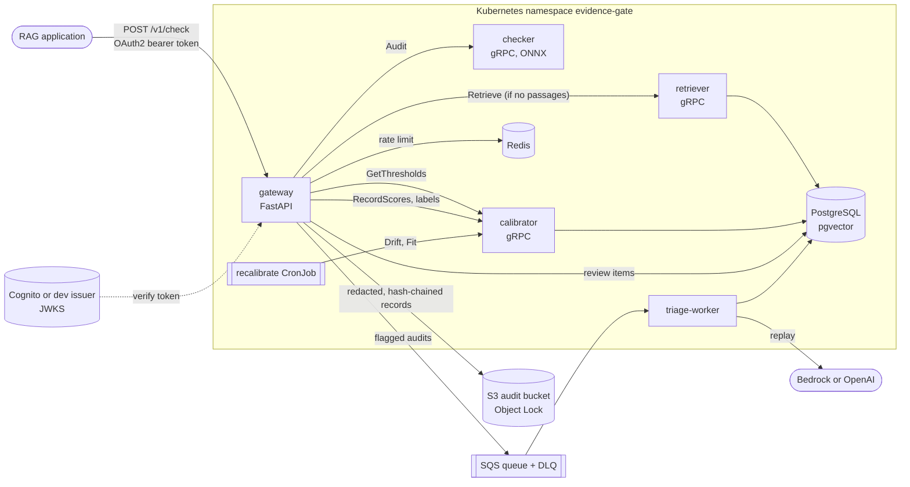

# Architecture

## One request

1. **Authenticate.** The gateway verifies the RS256 token against the issuer's JWKS and
   maps it to a tenant (a `tenant` claim, or the tenant registered for its `client_id`).
2. **Rate-limit.** A token bucket per tenant, atomic in Redis so every replica shares it.
3. **Retrieve, if needed.** Callers usually send the passages their model saw. If they
   don't, the retriever runs Postgres full-text search and a pgvector HNSW search, fuses
   them with reciprocal rank fusion and reorders the top 20 with a cross-encoder.
4. **Thresholds.** The calibrator returns the tenant's current threshold version.
5. **Check.** The checker runs Groundsight's audit with ONNX MiniCheck (support) and
   DeBERTa NLI (contradiction): every claim against every passage, in windows for long
   passages and jointly against all of them, plus a rule-based cause for each failure.
6. **Decide.** Pass when every claim is supported; flag when some claim is not; block
   when a claim is contradicted and the tenant's policy says to block.
7. **Record.** Support scores go to the calibrator (drift); flagged claims and a random
   audit sample go to the review queue; a redacted, hash-chained record goes to the audit
   bucket; flagged audits go to the triage queue. The response does not wait for triage.

## Why five services

| Service | Bound by | Scales on | Changes when |
|---|---|---|---|
| gateway | I/O | CPU (HPA), 2+ replicas | API or policy changes |
| checker | CPU (transformer inference) | CPU (HPA), canary on every release | the model changes |
| retriever | CPU and Postgres | CPU (HPA) | the embedder or corpus changes |
| calibrator | Postgres | 1 replica is enough | the statistics change |
| triage-worker | LLM latency | queue depth (KEDA, to zero) | the replay method changes |

The checker is the expensive part and the one whose model changes most often, so it
scales and ships (as an Argo Rollouts canary) on its own. A slow LLM in triage can never
slow the request path because triage is behind a queue. At low traffic a single process
would do; the split follows where the load test showed different needs.

## Data ownership

Each service owns a Postgres schema: `retriever` (passages and vectors), `calibrator`
(labels, threshold versions, live scores), `gateway` (review items, tenant registry) and
`triage` (replay results). No service reads another's tables; they talk over gRPC.

## Contracts

The gRPC APIs live in `proto/evidencegate/v1`. `buf lint` and `buf breaking` run in CI,
and CI fails if the generated Python stubs drift from the `.proto` files.
